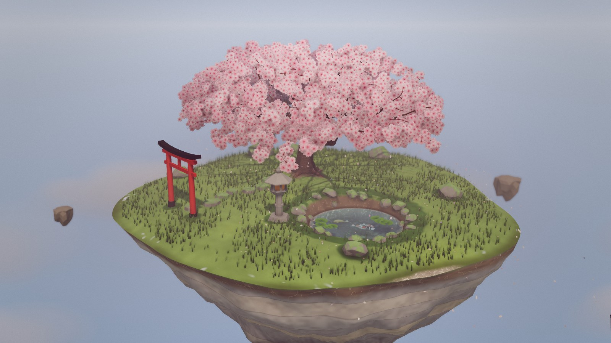
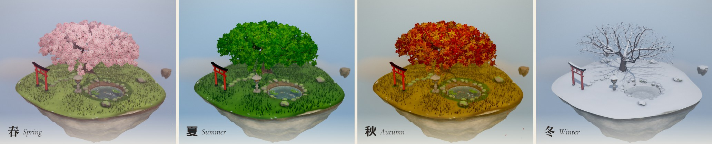
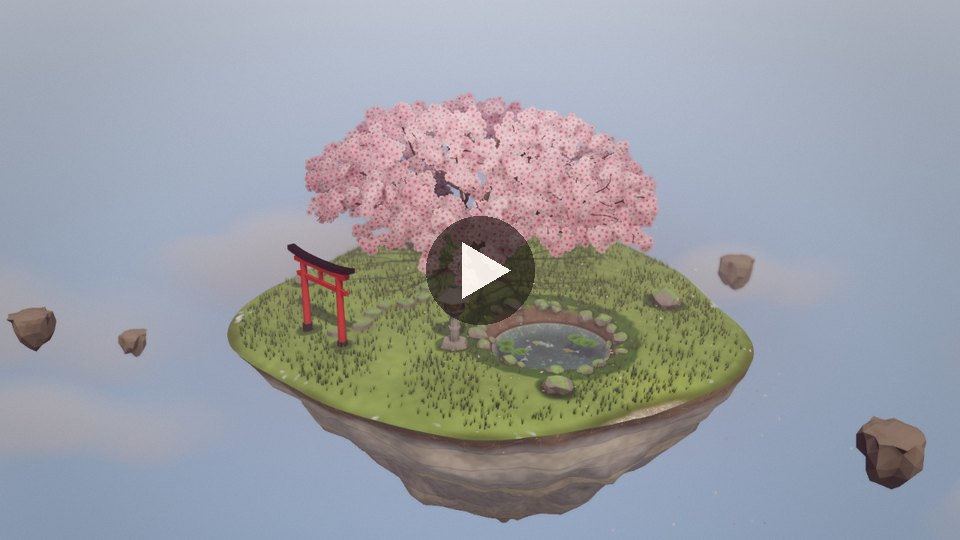
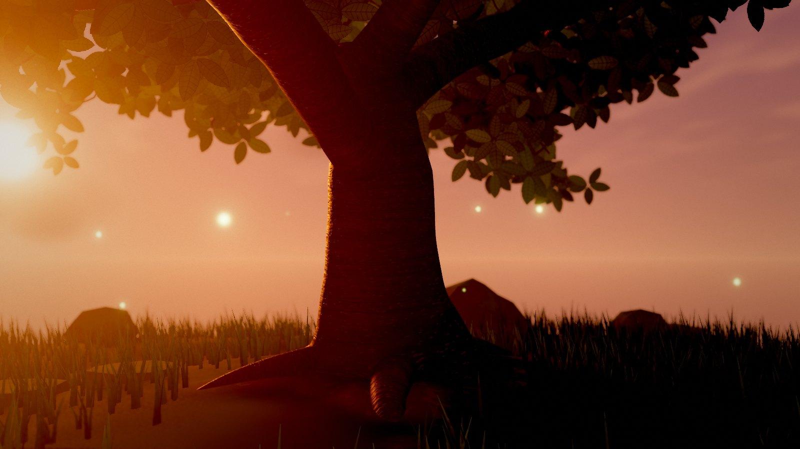
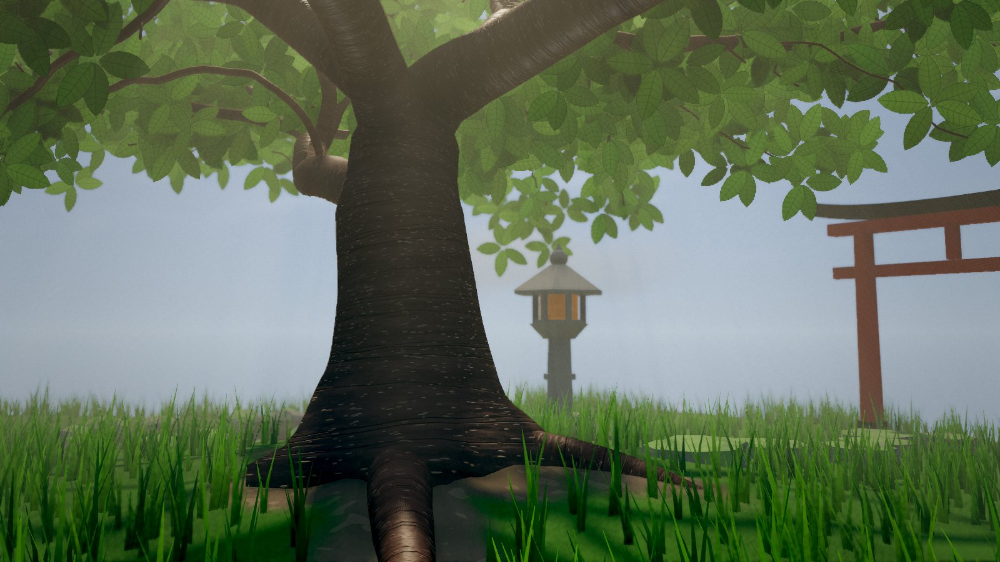

# 桜 Sakura: A Year of Life

**A floating island with a single cherry tree that lives through a whole year, rendered live in the browser.**
Scrub the timeline or press play. Blossoms open one by one and shed in a petal storm, leaves turn and fall, and snow settles on the branches while the koi slow down under the ice.





[](docs/screenshots/timeline.mp4)

*The timeline on autoplay in Cinematic, sped up to a whole year in 18 seconds (the app takes about 1.6 minutes). Click to play the MP4.*

Built with **Three.js** and **Vite** in plain JavaScript, with no other runtime dependencies. Every texture is
painted procedurally at startup, so there are no image or model assets to download.

---

## Features

- **A year in one slider.** Every visual parameter is a curve over the year, so all transitions blend continuously:
  - **春 Spring.** Buds swell, open into full bloom and shed in a petal storm. Petals drift down, settle on the grass and gather as rafts on the pond.
  - **夏 Summer.** A lush green canopy. From dusk, fireflies rise over the water.
  - **秋 Autumn.** Each leaf turns gold, orange or crimson on its own schedule, then falls.
  - **冬 Winter.** Bare branches and snowfall. Snow builds on branch tops, the torii and the lantern, and drifts into hollows. The pond freezes.
- **A grown tree, not a modelled one.** The cherry is grown with a space-colonization algorithm. Its branches are smooth tapered tubes with junction collars and a buttressed root flare, and the bark is procedural with horizontal lenticels.
- **Custom GLSL throughout.** Highlights:
  - one shared wind function sways the branches, canopy and grass together;
  - stateless GPU petals and leaves;
  - a refracting koi pond with caustics;
  - shader-animated koi;
  - two-sided seasonal grass;
  - snow that sparkles in sunlight.
- **Day, dusk and night.** The sun and moon share one light, and the sky has a soft sun, drifting cirrus, a moon and stars. The lantern lights up as the sun sets.
- **Cinematic finish.** Every preset gets:
  - ACES filmic tone mapping;
  - a per-season colour grade (pink-warm spring, saturated summer, amber autumn, cool winter);
  - a vignette and a light film grain.

  The opt-in **Cinematic** preset adds SSAO, volumetric fog with god rays through the canopy, and depth of field.
- **Photo mode** (`P`). Hides all UI for clean screenshots.
- **Built to run on modest hardware.** It holds 60 fps on a 2014 entry-level GPU on the Low preset. A quality governor picks the preset for you.

| Dusk: god rays through the canopy (Cinematic) | Grass level: depth of field, far field only (Cinematic) |
|---|---|
|  |  |

## Tech stack

| | |
|---|---|
| Rendering | [Three.js](https://threejs.org/) r186, WebGL 2, hand-written GLSL (ES 3.0) |
| Post-processing | three's `EffectComposer` with custom passes: MSAA scene pass, Unreal bloom, final grade pass, SSAO / volumetric fog / DOF pass, SMAA |
| Build | [Vite](https://vite.dev/) 8, ES modules, no framework |
| UI | Plain DOM + CSS (washi paper, sumi ink and a vermilion hanko seal) |
| Hosting | Static files: Vercel or GitHub Pages configs included |

## How to Run Locally

**Requirements:** [Node.js](https://nodejs.org/) 20.19+ or 22.12+ (required by Vite 8), and a browser with WebGL 2
(any current Chrome, Edge, Firefox or Safari).

1. Clone the repository and open a terminal in it:

   ```bash
   git clone https://github.com/vinithgomez/Sakura.git
   ```

   ```bash
   cd Sakura
   ```

2. Install dependencies:

   ```bash
   npm install
   ```

3. Start the dev server:

   ```bash
   npm run dev
   ```

4. Open **http://localhost:5190** in your browser. Add `?quality=cinematic` to the URL for the full cinematic preset.

To make an optimised production build and preview it locally:

```bash
npm run build
```

```bash
npm run preview
```

Then open the URL it prints (**http://localhost:4173** by default).

`npm run build` writes static files to `dist/`. The build uses relative asset paths, so the same output works at a domain root or under a sub-path.

> The UI fonts (Shippori Mincho, Cormorant Garamond) load from Google Fonts. Offline, the page falls back to system serif fonts and still works.

## Controls

| Input | Action |
|-------|--------|
| Drag | Orbit the island |
| Scroll / pinch | Zoom (down to 3.5 units; the camera stays above the ground and water) |
| Timeline | Drag to scrub through the year; click 春 夏 秋 冬 to jump to a season |
| **Play** / `Space` | Auto-play the year (≈1.6 min per year, with a slow cinematic orbit) |
| **Day / Dusk / Night** / `N` | Cycle the time of day |
| `←` `→` | Previous / next season |
| **Photo** / `P` | Photo mode: hide all UI for clean screenshots (`Esc` or the corner chip exits) |
| `H` | Hide or show the UI |
| `F` | Show the FPS / quality readout |

A short **Controls** card appears after loading and fades on its own. The caption above the timeline shows the
current *sekki* (二十四節気), one of the 24 traditional Japanese solar terms that divide the year.

## Performance

### Presets

Every expensive effect is gated behind a quality preset:

| | **Low** | **High** | **Cinematic** (opt-in) |
|---|---|---|---|
| Pixel ratio | 1× | devicePixelRatio, up to 2× | devicePixelRatio, up to 2× |
| Anti-aliasing | SMAA | 4× MSAA | 4× MSAA |
| Sun shadow map | 1024² | 2048² | 2048² |
| Pond | alpha-blended water | refracting water + caustics on the floor | refracting water + caustics on the floor |
| Grass | 4,200 tufts | 12,000 finer tufts | 12,000 finer tufts |
| Snow | no sparkle | sparkling ice crystals in sunlight | sparkling ice crystals in sunlight |
| Ambient occlusion | – | – | SSAO |
| Atmosphere | – | – | volumetric fog with god rays through the canopy |
| Depth of field | – | – | far-field only, focused on the orbit target |

All three share bloom, ACES tone mapping, the season grade, vignette, grain, the sky and a soft bounce light under the
island. Thin twigs keep a minimum on-screen width on every preset, and shadows use a 12-tap soft filter whose penumbra
stays the same width at either shadow-map size.

### Auto-fallback

1. While the loading screen is up, a short GPU-synced benchmark renders the **High** preset. If that runs under **30 fps**, the app starts on **Low**.
2. On High, three seconds below 30 fps at runtime also switches to Low. It never switches back on its own.
3. `?quality=low`, `?quality=high` or `?quality=cinematic` pins a preset. A pinned preset is never changed at runtime.
4. **Cinematic is never chosen automatically.** You opt in through the URL.

### Measured frame times

These were measured on a **GeForce GT 730** (a 2014 entry-level card, well below a mid-range laptop) at **1280×720**, with GPU-synced timing (median of 60 frames). The view is the default camera by day:

| Preset | Summer (heaviest season) | Winter |
|---|---|---|
| Low | **13.3 ms (75 fps)** | **11.3 ms (88 fps)** |
| High | 22.7 ms (44 fps) | 18.2 ms (55 fps) |
| Cinematic | 26.6 ms (38 fps) | 25.5 ms (39 fps) |

These were measured on the v1.0.5 production build. At grass level beside the pond in summer (the worst case for
fill rate), Low measured 15.3 ms (65 fps) and High 24.9 ms. **Low holds 60 fps on that card at 1280×720.**

**At 1920×1080** the same card is fill-rate bound: the startup benchmark measures High at about 40 ms (25 fps) and
starts on Low, which then runs at roughly 38–40 fps. For 60 fps on this class of card, use a smaller window. A typical mid-range laptop GPU (Iris Xe, MX-series, RTX 3050 laptop) has roughly
three times that headroom.

What made that possible:
- The whole tree is one merged mesh, and everything else is instanced, at about 25 draw calls.
- The canopy casts shadows through half-density proxies, since the sprites were most of the shadow-map fill.
- The ground's ~17 noise evaluations per pixel are baked once into mipmapped textures, which saved ~5 ms on the GT 730.
- MSAA is kept out of the post-processing ping-pong buffers. The scene resolves once.
- The final pass (tone mapping, grade, vignette, grain) replaced three's output pass at the same cost. The cinematic look is free on Low and High.

## Known issues

- After a lost WebGL context is restored, the browser can report a single `INVALID_OPERATION` (WebGL error 1282) while
  the ground textures are rebaked. Every frame afterwards is clean and the image is unaffected.
- On Low (no MSAA), thin leaf edges shimmer slightly while orbiting. High and Cinematic anti-alias them.
- On Cinematic at 1280×720, faint horizontal and vertical lines can show over flat, bright areas such as snow in
  close-ups. Low and High are unaffected.
- At dusk the inside of the canopy goes very dark, losing detail between the lit outer leaves.

## Deploy

The build is static, so any static host works. Configs for two are included.

**Vercel** ([vercel.json](vercel.json)):
1. Push the project to a GitHub repository.
2. At [vercel.com/new](https://vercel.com/new), import that repository. The Vite settings are picked up automatically: build `npm run build`, output `dist/`.
3. Click **Deploy**.

To deploy straight from your machine instead, run `npx vercel --prod` in the project folder.

**GitHub Pages** ([.github/workflows/deploy.yml](.github/workflows/deploy.yml)):
1. Push the project to a GitHub repository, on the `main` branch.
2. In the repository, open **Settings → Pages → Build and deployment** and set **Source** to **GitHub Actions**.
3. Every push to `main` builds and publishes to `https://vinithgomez.github.io/Sakura/`. The relative base path means nothing needs renaming.

## What I built / challenges solved

**A space-colonization tree.** Hand-placed branches looked like a diagram, so the cherry is grown instead:
- **Growth.** A short trunk with scaffold limbs grows toward ~4,000 attraction points that fill a lumpy, umbrella-shaped crown leaning over the pond. Branch radii follow the pipe model.
- **Shaping.** A second pass kinks the joints, so the limbs read as gnarled. It also droops each branch by lever arm over stiffness, so thin outer branches arch and weep the way a cherry's do.
- **Tubes.** Each branch is swept as a Catmull-Rom tube with junction collars. A fork that bent too sharply would fold its rings into a crease, so tight bends are split into forks instead.

**The tree looked hollow from some angles: an inverted-winding bug.**
- **Symptom.** From some angles the trunk base looked like an open shell, and thin branches vanished when seen edge-on.
- **Diagnosis.** It was tempting to hide this with double-sided materials. Instead I counted triangle orientation against the tube axis and found **99.8 % of the tube triangles were wound inward**. Back-face culling was removing the outside of the tree and showing its inside.
- **Fix.** The fix was in the tube builder itself: outward winding, end caps and a closed trunk base, plus a minimum of 8 radial segments so thin branches stay round. The near plane moved to 0.05 so close-ups don't slice the bark.

**Dark speckles in the snow, on one driver only.**
- **Symptom.** The winter ground showed dark speckles on the GT 730 (Chrome on ANGLE → Direct3D 11), but not on other GPUs.
- **Cause.** The sparkle shader skipped work with an `if` whose condition varied from pixel to pixel. After ANGLE translated it to HLSL, that non-uniform branch produced garbage on some pixels.
- **Fix.** The glint is now computed branch-free: the same maths, always evaluated and masked. It costs no more, and the result is identical on every GPU. (A separate artefact, vertical streaks in the snow, came from 2D noise stretched over steep faces. It was fixed by switching to 3D noise.)

**Fog that read as subtle by day and blew out at dusk.**
- **Cause.** The volumetric fog marches through the sun's own shadow map, so the canopy carves real shafts. But a low sun shines along the whole haze layer and straight into the lens.
- **Fix.** The forward-scattering peak is capped, and density and shaft strength now scale with sun elevation.

## How it works

The full plan is in [ARCHITECTURE.md](ARCHITECTURE.md). In short:

- **One float drives the world.** The year is `year ∈ [0, 1)`, and every visual parameter is a cyclic keyframe curve over it ([seasons.js](src/systems/seasons.js)). Per-instance random thresholds in the shaders turn those curves into one-by-one transitions.
- **Custom GLSL does the motion.**
  - One `windOffset()` ([wind.glsl](src/shaders/wind.glsl)) sways branches, canopy and grass coherently.
  - Petals and leaves are stateless GPU particles whose whole flight is a pure function of time ([falling.vert](src/shaders/falling.vert)).
- **The pond** has soft analytic ripples, a fresnel sky reflection and depth-based colour. On High it refracts the frame's own image of the pond floor. The koi swim with a vertex-shader body wave ([water.frag](src/shaders/water.frag), [koi.vert](src/shaders/koi.vert)).
- **The land** has mounds and root heave. Its edge shows humus over rock strata, and moss grows near water and stone. The grass is instanced and two-sided, and the snow drifts into hollows ([island.js](src/systems/island.js), [grass.js](src/systems/grass.js)).
- **Post-processing:**
  - The scene renders into an MSAA half-float target, then bloom runs.
  - On Cinematic, a depth-based SSAO, shadow-mapped fog and DOF pass is added ([cinematicPass.js](src/core/cinematicPass.js)).
  - One final pass does the tone mapping, grading, vignette and grain ([finalPass.js](src/core/finalPass.js)).
- **Startup.** A tiny entry chunk ([main.js](src/main.js)) checks for WebGL 2 and shows the loading progress. Then it loads the app ([app.js](src/app.js)), which builds the world step by step. If WebGL is unavailable, a short explanation appears instead.

## Project structure

```
src/
├─ main.js               entry: WebGL 2 check, loading screen, loads app.js
├─ app.js                builds the world, frame loop, startup benchmark
├─ styles.css            UI styling
├─ core/                 renderer + quality governor, post-processing (MSAA/SMAA,
│                        bloom, final grade pass, cinematic SSAO/fog/DOF),
│                        soft-shadow patch, shared uniforms, material
│                        patching, curves, PRNG, world layout
├─ systems/
│  ├─ seasons.js         year timeline → blended season state
│  ├─ lighting.js        sun/moon, ambient, bounce light, fog, day ↔ dusk ↔ night
│  ├─ grading.js         per-season colour grade
│  ├─ sky.js             sky dome (soft sun, cirrus, moon, stars) + drifting clouds
│  ├─ tree.js            grows the tree, bark material, blossom & leaf canopy
│  ├─ particles.js       petals, falling leaves, snow, fireflies
│  ├─ island.js          terrain, soil & rock strata, moss, snow, pond + koi, torii, lantern
│  ├─ grass.js           instanced two-sided grass that follows the seasons
│  ├─ loader.js          loading screen progress + WebGL fallback message
│  └─ ui.js              timeline, captions, buttons, keyboard, controls card, photo mode
├─ tree/
│  ├─ spaceColonization.js  space-colonization growth + pipe-model radii
│  └─ branchMesh.js         skeleton chains → smooth tube mesh
├─ textures/             procedural textures (bark maps, blossom/leaf atlas, clouds)
└─ shaders/              all GLSL (wind, foliage, particles, sky, water, koi…)
docs/screenshots/        README images
vercel.json              Vercel config
.github/workflows/       GitHub Pages deploy workflow
```

For console tinkering, the systems are exposed on `window.__sakura`. For example, `__sakura.seasons.setTarget(0.72)`
jumps to peak autumn.
